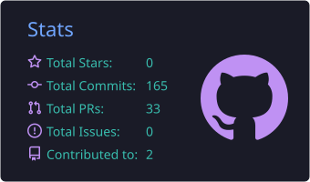
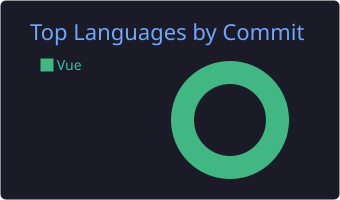

<!-- ============================== HEADER ============================== -->

  

  

  
  
  
  

  

## 👋 About me

> I'm a versatile software developer. When I need a new tool, I build it myself — like my custom Chrome extension and Discord bot. I enjoy exploring new technologies that deliver great results for any given project.

- 🧑‍💻 **Full stack developer** based in Curitiba, Brazil
- 🏥 Building **DM Gestão**, a SaaS platform for healthcare professionals
- 🔐 Currently learning **Cybersecurity**
- 🎮 Gamer at heart — FPS, platformers, strategy, RPGs and **VR**

## 🚀 Featured projects

<table>
  <tr>
    <td width="50%" valign="top">
      <h3>🏥 DM Gestão</h3>
      

        What started as a clinic's internal system grew into a <b>SaaS management platform</b> for any healthcare professional — podiatrists, nurses, physicians, physiotherapists, dentists and more.
      

      <ul>
        <li>Scheduling with online booking</li>
        <li>Electronic health records &amp; prescriptions</li>
        <li>Inventory, billing and multi-clinic support</li>
        <li>Privacy by design: encrypted patient data, audited access, LGPD compliant</li>
        <li>Digital signatures with <b>ICP-Brasil</b> certificates</li>
      </ul>
      

        
        
        
      

    </td>
    <td width="50%" valign="top">
      <h3>📺 Streaming-Next</h3>
      

        My personal <b>Chrome extension</b> to keep track of the Twitch livestreams I follow. Actively maintained, with new features added as soon as the APIs make them available.
      

      

        
        
      

      

        <a href="https://chromewebstore.google.com/detail/kjhokibigaobhcmjabhjbhncapklgjkb"><b>→ Get it on the Chrome Web Store</b></a>
      

    </td>
  </tr>
  <tr>
    <td width="50%" valign="top">
      <h3>🦶 DM Podiatria</h3>
      

        A website about <b>podiatry</b> I developed for a family member, built with Nuxt.js.
      

      

        
      

      

        <a href="https://www.dmpodiatria.com"><b>→ Visit dmpodiatria.com</b></a>
      

    </td>
    <td width="50%" valign="top">
      <h3>🤖 Mayuri</h3>
      

        My custom <b>Discord bot</b> for my personal server. It manages channels and messages, and uses the IGDB API to list upcoming game releases and free games.
      

      

        
        
      

    </td>
  </tr>
</table>

## 💻 Tech stack

  

  
  
  

## 📊 GitHub stats

  
  

  

## 📚 Currently learning

I'm starting a **Cybersecurity** course. What I know today is enough to build app authentication flows and set up network firewalls, but I want to go deeper and expand my skills in this area.

## ⚡ Fun facts

<b>🚦 Smart traffic light system</b>

 
Back in university, I worked on a team project to build a smart traffic light system for intersections. It used a <b>16-bit PIC microcontroller</b> to count passing cars and measure their speed, using that data to log traffic patterns and dynamically adjust the green light duration.

<b>🪟 Automated motorized window</b>

 
An <b>Arduino</b>-powered window that could be scheduled to open and close at specific times.

<b>🎸 Guitar Hero in Assembly</b>

 
I once developed a "Guitar Hero" clone entirely in <b>Assembly for the Intel 8086</b> processor. Unfortunately, the source code got lost to time on my old machines!

<b>🎮 Gaming</b>

 
Besides development, my main hobby is gaming. Lately I've been playing a lot of <b>FPS, platformers, strategy and RPGs</b> — and I love playing these genres in <b>VR</b>.

<!-- ============================== FOOTER ============================== -->

  

